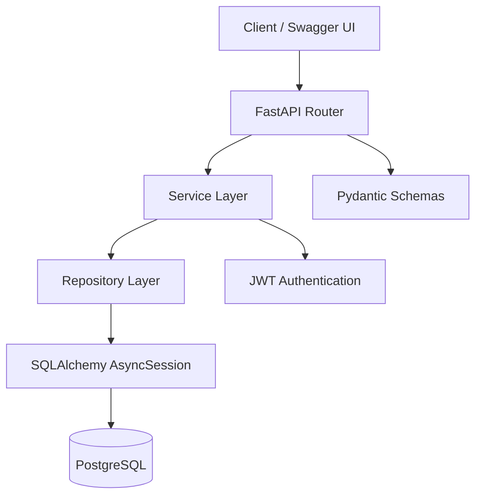
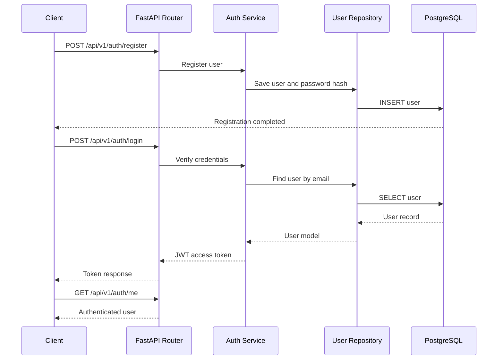
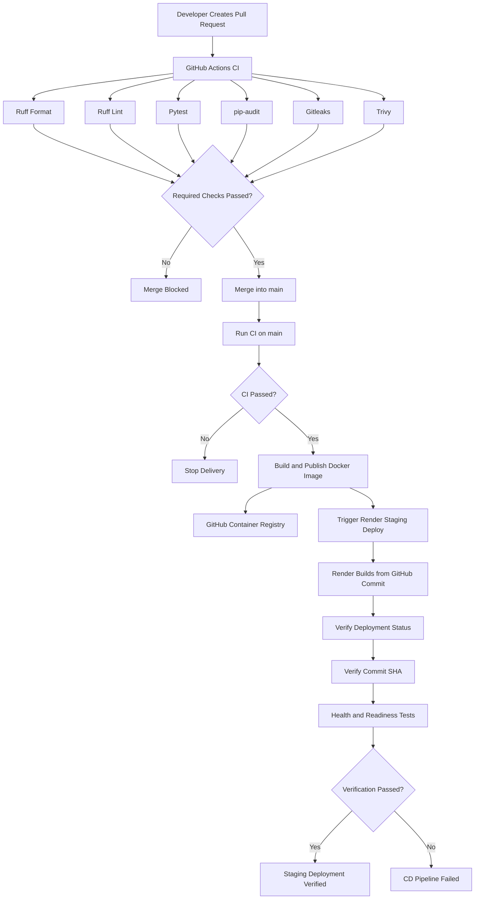

# FastAPI Production Lab

[](https://github.com/NamNguyen0903/fastapi-production-lab/actions/workflows/ci.yml)


**A production-oriented FastAPI backend with automated CI/CD, DevSecOps security scanning, Docker image publishing, and cloud deployment on Render.**

FastAPI Production Lab is a hands-on Backend Engineering and DevOps project demonstrating how to build, test, containerize, secure, deploy, monitor, and recover a modern Python REST API.

The project extends the open-source [FastAPI Production Starter](https://github.com/devanasly/fastapi-production-starter) with a practical CI/CD pipeline, security gates, container hardening, deployment verification, and rollback exercises.

### Live Demo

| Resource | URL |
|---|---|
| Live Staging API | https://fastapi-production-lab.onrender.com |
| Swagger UI | https://fastapi-production-lab.onrender.com/docs |
| ReDoc | https://fastapi-production-lab.onrender.com/redoc |
| Health Check | https://fastapi-production-lab.onrender.com/api/v1/health |
| Readiness Check | https://fastapi-production-lab.onrender.com/api/v1/ready |
| GitHub Actions | [CI/CD Workflow](https://github.com/NamNguyen0903/fastapi-production-lab/actions) |

> **Status:** Functional staging/demo environment. This project is not approved for production use. Outstanding security vulnerabilities and operational limitations are documented below.
>
> **Hosting note:** The application runs on Render's Free tier. Services may take additional time to respond after periods of inactivity.

---

## 1. Project Overview

The objective of FastAPI Production Lab is to demonstrate the complete software delivery lifecycle of a Python backend application.

Instead of focusing only on writing API endpoints, the project explores how backend applications are managed throughout development, testing, deployment, and recovery.

### Project Objectives

- Build a maintainable REST API with clean architecture.
- Implement secure authentication using JWT.
- Manage relational data with PostgreSQL.
- Handle database schema changes using Alembic.
- Containerize the application using Docker.
- Automate testing and static code analysis.
- Identify security vulnerabilities before deployment.
- Publish versioned Docker images to GHCR.
- Automatically deploy approved commits to Render staging.
- Verify deployment status, commit SHA, and application health.
- Practice monitoring, rollback, and failure recovery.

### Key Features

**Backend Development**
- RESTful API endpoints with FastAPI
- Layered Router–Service–Repository architecture
- Asynchronous database operations
- JWT bearer authentication
- Argon2 password hashing
- Pydantic validation
- Centralized exception handling
- Configurable logging and CORS

**Database**
- PostgreSQL persistence
- SQLAlchemy 2.x asynchronous ORM
- Alembic database migrations
- Database readiness checks

**DevOps**
- Docker and Docker Compose
- GitHub Actions CI/CD
- Automated Docker image builds
- GitHub Container Registry publishing
- Render staging deployments
- Commit SHA verification
- Automated post-deployment smoke tests

**Security**
- Dependency vulnerability scanning with pip-audit
- Secret detection with Gitleaks
- Container vulnerability scanning with Trivy
- GitHub branch protection
- Required CI checks
- Non-root Docker execution
- Container privilege restrictions
- Documented vulnerability risk management

---

## 2. Technology Stack

| Category | Technology |
|---|---|
| Programming Language | Python 3.12+ |
| Backend Framework | FastAPI |
| Database | PostgreSQL |
| ORM | SQLAlchemy 2.x Async |
| Database Driver | asyncpg |
| Database Migrations | Alembic |
| Data Validation | Pydantic v2 |
| Application Settings | pydantic-settings |
| Authentication | JWT / PyJWT |
| Password Hashing | pwdlib / Argon2 |
| API Testing | Pytest, HTTPX, pytest-asyncio |
| Code Formatting | Ruff |
| Static Analysis | Ruff |
| Dependency Security | pip-audit |
| Secret Scanning | Gitleaks |
| Container Security | Trivy |
| Containerization | Docker |
| Local Orchestration | Docker Compose |
| Version Control | Git & GitHub |
| CI/CD Platform | GitHub Actions |
| Container Registry | GitHub Container Registry |
| Cloud Hosting | Render |
| Managed Database | Render PostgreSQL |

---

## 3. Application Architecture

The backend follows a layered architecture designed to separate HTTP handling, business logic, and database access.



### Layer Responsibilities

| Layer | Responsibility |
|---|---|
| Router | Handles HTTP requests and responses |
| Schema | Validates incoming and outgoing data |
| Service | Implements application business logic |
| Repository | Encapsulates database operations |
| Model | Defines SQLAlchemy database entities |
| Database | Stores persistent application data |
| Core | Manages configuration, security, and exceptions |

This architecture improves maintainability, separation of concerns, and testability.

---

## 4. Project Structure

```text
fastapi-production-lab/
│
├── .github/
│   └── workflows/
│       └── ci.yml
│
├── app/
│   ├── api/
│   │   ├── dependencies.py
│   │   └── v1/
│   │       ├── endpoints/
│   │       │   ├── auth.py
│   │       │   ├── health.py
│   │       │   └── users.py
│   │       └── router.py
│   │
│   ├── core/
│   │   ├── config.py
│   │   ├── exceptions.py
│   │   ├── logging.py
│   │   └── security.py
│   │
│   ├── db/
│   │   ├── base.py
│   │   └── session.py
│   │
│   ├── models/
│   │   └── user.py
│   │
│   ├── repositories/
│   │   └── user_repository.py
│   │
│   ├── schemas/
│   │   ├── auth.py
│   │   ├── common.py
│   │   └── user.py
│   │
│   ├── services/
│   │   └── auth_service.py
│   │
│   └── main.py
│
├── alembic/
├── docs/
│   └── security/
│       └── risk-register.md
│
├── tests/
│
├── .env.example
├── .gitignore
├── Dockerfile
├── docker-compose.yml
├── alembic.ini
├── pyproject.toml
├── LICENSE
└── README.md
```

---

## 5. Getting Started

### Prerequisites

Before running the project, install:

- Git
- Python 3.12+
- Docker
- Docker Compose

PostgreSQL is required when running the application outside Docker Compose.

### Clone the Repository

```bash
git clone https://github.com/NamNguyen0903/fastapi-production-lab.git

cd fastapi-production-lab
```

### Configure Environment Variables

Create a local environment file:

```bash
cp .env.example .env
```

Generate a secure JWT secret:

```bash
openssl rand -hex 32
```

Update `.env` with the appropriate local database credentials and JWT secret.

For example:

```env
APP_ENV=development
DEBUG=true

JWT_SECRET_KEY=<your-generated-secret>

BACKEND_CORS_ORIGINS=["http://localhost:3000","http://localhost:8000"]
```

The application expects `BACKEND_CORS_ORIGINS` to be represented as a JSON array when loaded through Pydantic Settings.

**Security:** Never commit `.env`, API keys, passwords, or database connection credentials to GitHub.

---

## 6. Running with Docker Compose

Build and start the services:

```bash
docker compose up -d --build
```

The default Compose setup contains:

- FastAPI application
- PostgreSQL database
- PostgreSQL health checks
- Persistent PostgreSQL volume

The application is exposed on:

```text
http://localhost:8000
```

**Configuration note:** The original Compose configuration may contain a comma-separated CORS value. Update it to a valid JSON array or supply an appropriate Compose override before running.

Apply database migrations:

```bash
docker compose exec api alembic upgrade head
```

Verify migration status:

```bash
docker compose exec api alembic current
```

Check running services:

```bash
docker compose ps
```

View application logs:

```bash
docker compose logs -f api
```

Stop the services:

```bash
docker compose down
```

The PostgreSQL named volume is preserved unless explicitly removed.

---

## 7. Local Python Development

Create a virtual environment:

```bash
python3.12 -m venv .venv
```

Activate it on macOS or Linux:

```bash
source .venv/bin/activate
```

For Windows PowerShell:

```powershell
.venv\Scripts\Activate.ps1
```

Install application and development dependencies:

```bash
python -m pip install --upgrade pip

python -m pip install ".[dev]"
```

Start the FastAPI development server:

```bash
uvicorn app.main:app --reload
```

Access the API documentation:

```text
http://localhost:8000/docs
```

Ensure the configured PostgreSQL instance is available before using database-dependent endpoints.

---

## 8. Environment Variables

The application uses Pydantic Settings for environment-based configuration.

| Variable | Description |
|---|---|
| `APP_NAME` | Application name |
| `APP_ENV` | Application configuration mode |
| `DEBUG` | Enable development debugging |
| `LOG_LEVEL` | Logging verbosity |
| `API_V1_PREFIX` | API prefix |
| `DATABASE_URL` | Asynchronous database connection string |
| `DATABASE_ECHO` | SQLAlchemy query logging |
| `JWT_SECRET_KEY` | Secret for signing JWTs |
| `JWT_ALGORITHM` | JWT signing algorithm |
| `ACCESS_TOKEN_EXPIRE_MINUTES` | JWT expiration period |
| `BACKEND_CORS_ORIGINS` | Allowed CORS origins |

Supported application environment values:

```text
development
testing
production
```

The Render staging service uses:

```text
APP_ENV=production
```

This enables the application's production-oriented validation while the infrastructure itself remains a staging/demo environment.

Sensitive variables are configured through Render Environment Variables and GitHub Actions Secrets.

---

## 9. Database Migrations

Alembic manages database schema changes.

### Check Migration Heads

```bash
alembic heads
```

### Check Current Database Revision

```bash
alembic current
```

### Apply Pending Migrations

```bash
alembic upgrade head
```

### Generate a New Migration

After changing SQLAlchemy models:

```bash
alembic revision --autogenerate -m "describe change"
```

Review generated migration code before applying it.

### Render Database Migrations

The staging environment uses Render Managed PostgreSQL.

Because the current setup uses the Render Free tier, migrations have been executed manually through a secure external PostgreSQL connection.

Alembic obtains the database URL from application settings.

Database migrations are **not currently executed automatically as part of the CI/CD deployment pipeline**.

---

## 10. REST API Endpoints

The API uses the `/api/v1` prefix.

| Method | Endpoint | Description |
|---|---|---|
| `GET` | `/api/v1/health` | Application health check |
| `GET` | `/api/v1/ready` | Database readiness check |
| `POST` | `/api/v1/auth/register` | User registration |
| `POST` | `/api/v1/auth/login` | User authentication |
| `GET` | `/api/v1/auth/me` | Retrieve authenticated user |
| `GET` | `/api/v1/users/{user_id}` | Retrieve authorized user details |

### Authentication Flow



### JWT Authentication

Passwords are hashed using Argon2.

Upon successful authentication, the API returns an expiring JWT access token.

Protected endpoints require:

```http
Authorization: Bearer <access-token>
```

Refresh tokens are not implemented in the current starter.

---

## 11. Testing and Code Quality

The project uses Pytest for automated testing.

Run tests:

```bash
pytest -q
```

Tests use isolated asynchronous SQLite storage rather than the deployed PostgreSQL database.

### Ruff Formatting

```bash
ruff format --check .
```

### Ruff Linting

```bash
ruff check .
```

### Automatically Format Python Code

```bash
ruff format .
```

### Verified Staging Tests

The following scenarios were successfully tested on Render staging:

| Test Case | Expected | Result |
|---|---|---|
| Register user | HTTP 201 | Passed |
| Login | HTTP 200 | Passed |
| Access `/auth/me` without token | HTTP 401 | Passed |
| Access `/auth/me` with JWT | HTTP 200 | Passed |
| Health check | HTTP 200 | Passed |
| Database readiness | HTTP 200 | Passed |

These tests validate core authentication and database connectivity, but do not replace comprehensive production testing.

---

## 12. Continuous Integration

GitHub Actions runs automatically on:

- Pull requests
- Pushes to `main`

The CI workflow contains six independent quality and security jobs.

| Job | Purpose |
|---|---|
| Ruff Format | Validate Python code formatting |
| Ruff Lint | Detect code-quality issues |
| Pytest | Execute automated tests |
| Dependency Audit | Audit Python dependencies |
| Gitleaks Secret Scan | Detect accidentally committed secrets |
| Trivy Image Scan | Scan Docker images for vulnerabilities |

### Branch Protection

The `main` branch is protected by GitHub Rulesets.

Merging requires successful completion of the six required checks.

This prevents pull requests with failing quality or security checks from being merged through the normal process.

### Failure Testing

The pipeline was tested using controlled failure simulations:

- Ruff formatting failure
- Dependency Audit failure
- Trivy security gate failure

The exercises verified that required checks failed and GitHub blocked merging as configured.

---

## 13. DevSecOps Security Scanning

Three tools are integrated into GitHub Actions.

### 13.1 pip-audit

Checks installed Python dependencies for known vulnerabilities.

```bash
python -m pip_audit --local
```

The audit runs in an isolated GitHub Actions environment.

### 13.2 Gitleaks

Scans Git history for potential exposed credentials such as:

- API keys
- Access tokens
- Passwords
- Private secrets

```bash
gitleaks git --redact .
```

Local `.env` files are excluded from version control.

### 13.3 Trivy

Trivy scans the built Docker image for known vulnerabilities.

The pipeline implements two scanning behaviors.

**Full Vulnerability Report**

Reports all detected HIGH and CRITICAL findings, including those without available fixes.

**Fixable Vulnerability Gate**

Blocks the pipeline when HIGH or CRITICAL vulnerabilities with known fixes remain unresolved.

The current pipeline excludes one investigated pip vendored SBOM metadata file. This exception may reduce scan visibility and requires periodic review.

### Container Hardening

The project includes:

- Non-root application user
- Limited effective Linux capabilities
- Seccomp filtering in the tested Docker environment
- `no-new-privileges` in Docker Compose
- No privileged container execution in the tested configuration

These controls reduce certain attack opportunities but do not eliminate all vulnerabilities.

---

## 14. CI/CD Pipeline

The project implements automated staging delivery using GitHub Actions, GHCR, and Render.

### CI/CD Workflow



### Deployment Stages

1. Developer opens a pull request.
2. GitHub Actions executes tests and security checks.
3. Branch protection requires successful checks.
4. Approved changes are merged into `main`.
5. CI runs again on the `main` commit.
6. A Docker image is built and published to GHCR.
7. GitHub Actions triggers Render staging deployment.
8. Render builds and deploys the selected GitHub commit.
9. GitHub Actions monitors deployment status.
10. The deployed commit SHA is verified.
11. Health and readiness endpoints are checked.
12. The deployment job reports success or failure.

---

## 15. Docker Image Publishing to GHCR

After CI succeeds on `main`, GitHub Actions publishes a Docker image to GitHub Container Registry.

### Image Naming Convention

```text
ghcr.io/namnguyen0903/fastapi-production-lab:sha-<commit-sha>
```

Each image tag references a specific Git commit.

This improves:

- Traceability
- Release identification
- Artifact management
- Debugging
- Reproducibility of release selection

### GHCR Authentication

GitHub Actions uses `GITHUB_TOKEN` with the minimum required package publishing permission.

Registry credentials are not hardcoded in the repository.

### Important Artifact Limitation

The current Render staging Web Service is configured using **GitHub source deployment with a Dockerfile**.

Therefore:

- GitHub Actions publishes a Docker image to GHCR.
- Render independently builds a Docker image from the selected GitHub commit.
- Commit SHA verification confirms source-level traceability.
- The process does not guarantee that Render runs the exact binary artifact stored in GHCR.

Deploying directly from a prebuilt GHCR image is a potential future improvement.

---

## 16. Automated Deployment to Render

Render hosts the staging FastAPI application and PostgreSQL database.

### Staging URL

https://fastapi-production-lab.onrender.com

### Deployment Configuration

| Setting | Value |
|---|---|
| Platform | Render |
| Service Type | Docker Web Service |
| Branch | `main` |
| Application Port | `8000` |
| Environment | Staging/demo |
| Native Auto-Deploy | Disabled |
| Deployment Trigger | GitHub Actions Deploy Hook |
| Database | Render PostgreSQL |

### GitHub Actions Configuration

The following GitHub configuration values are used:

| Name | Type | Description |
|---|---|---|
| `RENDER_DEPLOY_HOOK_URL` | Secret | Triggers Render deployment |
| `RENDER_API_KEY` | Secret | Authenticates Render API calls |
| `RENDER_SERVICE_ID` | Variable | Identifies the staging Web Service |

GitHub Actions deploys only after CI and image publishing complete successfully.

### Deployment Verification

The deployment job performs these checks:

1. Trigger Render deployment for the expected commit.
2. Retrieve the deployment ID.
3. Poll the Render API for deployment status.
4. Detect deployment failures and timeouts.
5. Wait until the deployment becomes `live`.
6. Verify the deployed commit SHA.
7. Check `/api/v1/health`.
8. Check `/api/v1/ready`.
9. Return a failure exit code if verification fails.

A successful deployment request alone is not considered proof of a successful release.

### Smoke Tests

Expected responses:

```text
GET /api/v1/health  → HTTP 200
GET /api/v1/ready   → HTTP 200
```

The readiness endpoint verifies connectivity to PostgreSQL.

---

## 17. Monitoring and Logging

The project uses Render Dashboard for basic operational monitoring.

### Monitoring Activities

- Inspect application logs
- Review deployment history
- Track deployment status
- Verify health and readiness
- Identify failed requests
- Investigate errors following deployments

### Health Check

```bash
curl -i https://fastapi-production-lab.onrender.com/api/v1/health
```

### Readiness Check

```bash
curl -i https://fastapi-production-lab.onrender.com/api/v1/ready
```

The project has not yet implemented a dedicated observability stack such as Prometheus and Grafana.

Monitoring capabilities are currently based on Render features and application logs.

---

## 18. Rollback and Recovery

Rollback procedures were practiced on the Render staging environment.

### Manual Rollback Procedure

1. Open the Render Dashboard.
2. Select the staging Web Service.
3. Open deployment history.
4. Identify a previously successful deployment.
5. Review application and database compatibility.
6. Select **Rollback**.
7. Confirm the rollback.
8. Wait for the deployment to become `Live`.
9. Verify the restored commit SHA.
10. Run health and readiness checks.

### Recovery Verification

The project includes a practical rollback and restore exercise:

- Rollback to a previously successful deployment
- Confirm the application becomes Live
- Verify the expected commit
- Run health and readiness checks
- Restore the newer deployment
- Verify the application is healthy again

### Important Limitation

**Application rollback does not roll back PostgreSQL data or database schema.**

Database migration compatibility and data recovery must be considered separately.

The current deployment pipeline does not automatically roll back a failed release.

---

## 19. Failure Simulation

Controlled failure tests were performed to validate CI/CD behavior.

| Scenario | Expected Behavior | Test Result |
|---|---|---|
| Ruff formatting failure | Fail CI and block merge | Passed |
| Dependency audit failure simulation | Fail security check and block merge | Passed |
| Trivy gate failure simulation | Fail security check and block merge | Passed |
| Deployment status `live` | Return exit code 0 | Passed |
| Deployment status `build_failed` | Return exit code 1 | Passed |
| Deployment status `update_failed` | Return exit code 1 | Passed |
| Unknown deployment status | Return exit code 1 | Passed |
| Rollback to previous deployment | Restore a working version | Passed |
| Restore newer deployment | Return to current version | Passed |

Deployment status failures were simulated locally. They were not induced against the actual Render service.

---

## 20. Security Risk Management

Security scanning is part of the delivery workflow, but passing the configured security gate does not mean the application has no vulnerabilities.

### Security Assessment Baseline

During the documented Trivy assessment:

| Metric | Result |
|---|---|
| Original HIGH findings | 48 |
| Original CRITICAL findings | 0 |
| Findings addressed through the zlib update | 1 |
| Remaining HIGH findings | 47 |
| Remaining CRITICAL findings | 0 |

The remaining vulnerabilities were documented for further evaluation.

The following actions were performed:

- Investigated affected Debian packages
- Grouped findings by CVE
- Compared Debian base images
- Tested an available `zlib1g` update
- Verified that the corresponding CVE disappeared from subsequent scans
- Reviewed container execution privileges
- Enabled `no-new-privileges`
- Documented outstanding risks

### Risk Register

See:

[Security Risk Register](docs/security/risk-register.md)

The risk register records:

- Vulnerability identifiers
- Affected packages
- Scanner status
- Known remediation
- Runtime mitigation evidence
- Outstanding assessment requirements

### Security Limitations

- 47 HIGH findings remained at the recorded assessment baseline.
- Outstanding risks have not been fully accepted or resolved.
- The fixable-vulnerability gate does not block all unfixed HIGH findings.
- An investigated SBOM file exclusion reduces scanning coverage.
- No comprehensive production security audit has been completed.
- Dependency locking and artifact reproducibility can be improved.
- Database backup and restoration have not been fully validated.

**This staging project must not be treated as production-approved solely because CI/CD passes.**

---

## 21. Operational Limitations

The project provides a functioning automated staging deployment pipeline, but several production capabilities remain outside the current scope.

| Area | Current Limitation |
|---|---|
| Hosting | Render Free tier |
| Database | Managed PostgreSQL staging environment |
| Database Migrations | Executed manually |
| Database Backup | Automated backup/restore validation not implemented |
| Rollback | Manual rollback procedure |
| Monitoring | Basic Render logs and metrics |
| Alerting | No dedicated incident alerting workflow |
| Deployment Artifact | Render rebuilds from GitHub source |
| Security | Outstanding HIGH vulnerabilities |
| Scalability | No load or performance certification |
| Disaster Recovery | Full recovery procedure not implemented |

These limitations are documented to distinguish a successful CI/CD learning project from a fully production-ready system.

---

## 22. Learning Outcomes

This project demonstrates hands-on experience with:

### Backend Engineering

- Designing REST APIs with FastAPI
- Implementing layered backend architecture
- Working with asynchronous SQLAlchemy
- Managing PostgreSQL databases
- Creating and applying Alembic migrations
- Implementing JWT authentication
- Building API tests

### DevOps and CI/CD

- Building Docker images
- Running multi-service Docker Compose applications
- Managing Git workflows and pull requests
- Implementing GitHub Actions pipelines
- Configuring required status checks
- Publishing container images to GHCR
- Deploying applications to Render
- Automating deployment verification
- Monitoring deployment status and logs
- Performing rollback and recovery exercises

### DevSecOps

- Detecting dependency vulnerabilities
- Detecting leaked credentials
- Scanning container images
- Implementing security gates
- Applying container hardening
- Investigating CVEs
- Documenting residual security risks
- Testing failure handling and recovery

---

## 23. Future Improvements

Potential improvements include:

- Deploying the exact GHCR artifact instead of rebuilding on Render
- Adding reproducible dependency lockfiles
- Integrating database migration checks into releases
- Implementing database backup and recovery verification
- Adding Prometheus and Grafana
- Configuring automated alerts
- Improving release rollback automation
- Adding integration tests against PostgreSQL
- Implementing performance and load tests
- Deploying the same application to an Ubuntu VPS
- Adding Nginx, HTTPS, and advanced server hardening
- Continuing CVE remediation and security risk reviews

---

## 24. Contributing

Contributions, issues, and suggestions are welcome.

When contributing:

1. Create a feature branch.
2. Follow the existing layered architecture.
3. Add or update tests.
4. Run Ruff and Pytest locally.
5. Open a pull request.
6. Ensure all required CI and security checks pass.

Do not commit secrets, credentials, or development environment files.

---

## 25. Credits and Attribution

This repository is based on the open-source project:

**FastAPI Production Starter**

Original author: **Anas Emad Alkhoddar**

- GitHub: https://github.com/devanasly
- Original Repository: https://github.com/devanasly/fastapi-production-starter
- Portfolio: https://devanas.ly
- LinkedIn: https://www.linkedin.com/in/anas-alkhoddar

The original project provides the backend starter architecture, including FastAPI, authentication, PostgreSQL integration, Alembic, Docker, and foundational testing.

The **FastAPI Production Lab** repository extends that foundation through practical CI/CD and DevSecOps work, including:

- GitHub Actions pipeline improvements
- Required quality and security checks
- Dependency, secret, and container scanning
- Docker hardening
- GHCR image publishing
- Render staging deployment automation
- Deployment monitoring and SHA verification
- Rollback and recovery exercises
- Security risk documentation

This attribution preserves recognition of the original author's work while distinguishing the additional engineering exercises implemented in this repository.

---

## 26. Maintainer

**Nguyen Trong Nam**

- GitHub: https://github.com/NamNguyen0903
- Project Repository: https://github.com/NamNguyen0903/fastapi-production-lab

**Project Focus:** Python Backend Development, REST APIs, Docker, CI/CD, DevOps, and DevSecOps.

---

## 27. License

This project is licensed under the **MIT License**.

See the [LICENSE](LICENSE) file for details.

The original FastAPI Production Starter project is also distributed under the MIT License. Original copyright and attribution notices must be retained as required by that license.

---

**FastAPI Production Lab — From Backend Development to Automated, Security-Aware Cloud Delivery.**