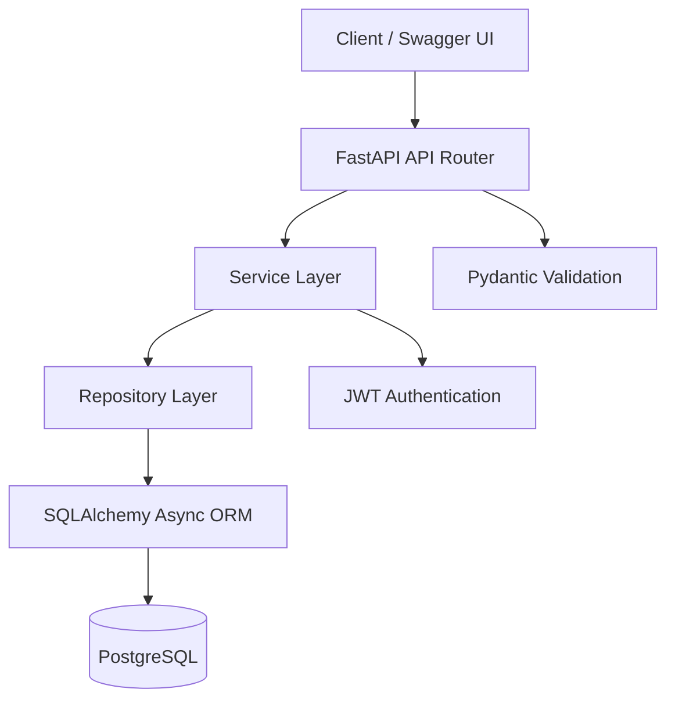
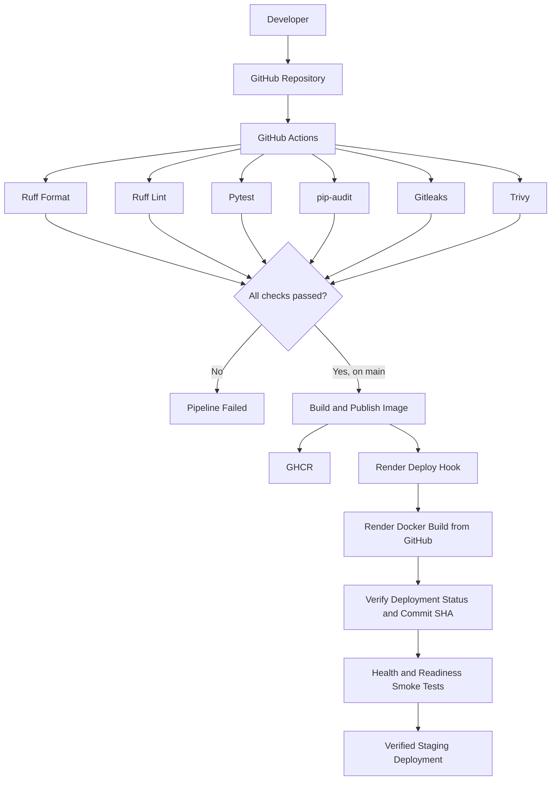
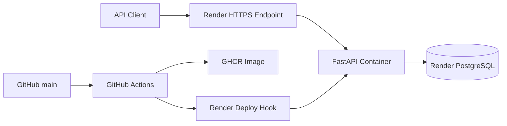

# FastAPI Production Lab — System Architecture

## 1. Overview

This document describes the application and CI/CD architecture of FastAPI Production Lab.

The system consists of a Python FastAPI backend, PostgreSQL database, Docker-based runtime, GitHub Actions automation, GitHub Container Registry, and Render staging infrastructure.

## 2. Application Architecture

### Component Responsibilities

| Component | Responsibility |
|---|---|
| FastAPI Router | HTTP request handling and routing |
| Pydantic | Request and response validation |
| Service Layer | Business logic and authentication |
| Repository Layer | Database access |
| SQLAlchemy | Asynchronous ORM |
| PostgreSQL | Persistent relational storage |
| Alembic | Schema migrations |

## 3. CI/CD Architecture

### Deployment Behavior

- Pull requests run the six quality and security checks.
- Branch protection requires all checks to pass before merging.
- A successful push to `main` triggers image publishing.
- The Docker image is published to GHCR using a commit SHA tag.
- Render staging deployment is triggered through GitHub Actions.
- Render builds the application from GitHub source.
- Deployment success is verified using Render API status, commit SHA, and HTTP smoke tests.
- Database migrations are managed using Alembic and currently executed separately.

**Artifact limitation:** The Render deployment does not directly consume the GHCR image.

## 4. Deployment Infrastructure

## 5. Security Controls

The system implements:

- GitHub required status checks and branch protection
- Ruff formatting and linting
- Pytest testing
- pip-audit dependency scanning
- Gitleaks secret scanning
- Trivy container scanning
- Non-root Docker execution
- `no-new-privileges` in the local Docker Compose configuration
- Environment-based secret management
- Deployment SHA verification

Security scanning does not guarantee the absence of vulnerabilities. The documented assessment baseline includes 47 unresolved HIGH findings.

See [Security Risk Register](../security/risk-register.md).

## 6. Reliability and Recovery

The project includes:

- Application health checks
- PostgreSQL readiness checks
- Deployment status polling
- Commit SHA verification
- HTTP smoke testing
- Render deployment rollback exercises
- Controlled CI and security failure simulations

Current limitations include manual database migrations, manual deployment rollback, and no fully validated database disaster-recovery process.

## 7. Future Improvements

- Deploy the exact GHCR image to the hosting platform
- Automate migration safety checks
- Add integration tests using PostgreSQL
- Implement automated backup and restore verification
- Introduce dedicated monitoring and alerting
- Improve dependency and container security posture
